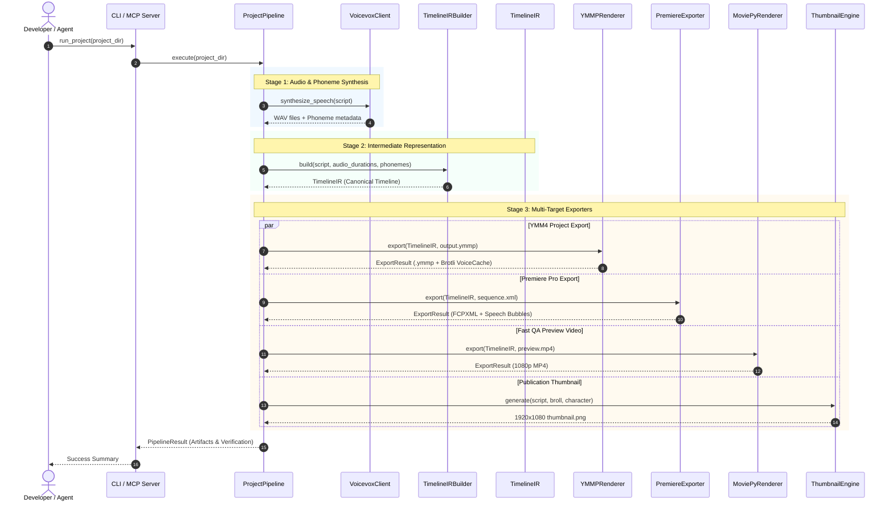

# Veraxi YMMP: Architectural Blueprint & System Design

This document details the architectural design, layer boundaries, data flow, fitness guardrails, and security invariants governing `veraxi-ymmp`.

---

## 1. Architectural Philosophy: Clean Architecture

`veraxi-ymmp` is organized according to the principles of **Clean Architecture** (Ports and Adapters / Hexagonal Architecture). The fundamental rule is the **Dependency Inversion Principle**:

> Source code dependencies must only point inwards, towards high-level policies and domain entities. Pure domain logic knows nothing about rendering frameworks, file formats, external web services, or delivery mechanisms.

```mermaid
flowchart TD
    subgraph Delivery ["Delivery Interfaces (Outer Layer)"]
        CLI["cli.py (CLI Commands)"]
        MCP["mcp_server.py (Model Context Protocol)"]
    end

    subgraph Infrastructure ["Infrastructure Adapters (Outer Layer)"]
        YMMP["ymmp_renderer.py (YMM4 .ymmp)"]
        Premiere["premiere_exporter.py (FCPXML)"]
        MoviePy["moviepy_renderer.py (Preview MP4)"]
        AE["ae_renderer.py (After Effects .jsx)"]
        SRT["srt_generator.py (SRT Subtitles)"]
        Norm["audio_normalizer.py (EBU R128)"]
        VoiceVox["voicevox.py (VOICEVOX HTTP API)"]
        PSD["psd_registry.py (Tachie PSDs)"]
        Broll["broll.py (B-Roll Layout Engine)"]
        Thumb["thumbnail.py (YouTube Thumbnails)"]
        Typo["typography.py (Kinsoku Shori & Plates)"]
    end

    subgraph Application ["Application Services (Middle Layer)"]
        Pipeline["pipeline.py (ProjectPipeline)"]
        Builder["ir_builder.py (TimelineIRBuilder)"]
        Compiler["compiler.py (YMMPCompiler)"]
        Validation["validation.py (QA Validator)"]
    end

    subgraph Ports ["Ports & Interfaces (Boundary Layer)"]
        P_Exporter["ports.py (TimelineExporter & ExportResult)"]
        P_TTS["ports.py (TTSBackend)"]
        P_Director["director.py / ports.py (DirectorProvider)"]
    end

    subgraph Domain ["Domain Core (Innermost Layer)"]
        IR["ir.py (TimelineIR, VoiceClip, DynamicClip)"]
        Script["script.py (WriterScript, DirectorScript)"]
        Const["constants.py (Timing, Canvas, Layout Presets)"]
    end

    CLI --> Pipeline
    MCP --> Pipeline
    Pipeline --> Builder
    Pipeline --> Validation
    Pipeline --> P_Exporter
    Builder --> IR
    Compiler --> IR
    YMMP -.->|implements| P_Exporter
    Premiere -.->|implements| P_Exporter
    MoviePy -.->|implements| P_Exporter
    AE -.->|implements| P_Exporter
    SRT -.->|implements| P_Exporter
    VoiceVox -.->|implements| P_TTS
    P_Exporter --> IR
    P_TTS --> Script
    Validation --> IR
```



---

## 2. Layer Definitions & Component Breakdown

### 2.1. Domain Layer (`veraxi_ymmp/ir.py`, `veraxi_ymmp/script.py`, `veraxi_ymmp/constants.py`)
- **`ir.py`**: Defines `TimelineIR`, the canonical Intermediate Representation of a multi-track timeline. Includes `IRClip`, `VoiceClip`, `CharacterClip`, `GlobalClip`, `DynamicImageClip`, and `DynamicAudioClip`. Timeline IR is completely decoupled from rendering logic, JSON schemas, XML dialects, or file systems.
- **`script.py`**: Typed data contracts for the two-stage authoring pipeline:
  - `WriterScriptEntry`: Pure factual dialogue (`character`, `text`).
  - `DirectorScriptEntry`: Dialogue enriched with staging metadata (`emotion`, `motion`, `bgm`, `sfx`, `image`, `character_position`, `subtitle_position`, `subtitle_style`).
- **`constants.py`**: Pure domain constants including standard frame rates (`DEFAULT_FPS = 60`), frame-per-character estimations, canvas dimensions (1920x1080), BGM ducking targets, and character definitions.

### 2.2. Ports & Protocols Layer (`veraxi_ymmp/ports.py`, `veraxi_ymmp/director.py`)
- **`TimelineExporter`**: Protocol defining the unified export contract:
  ```python
  class TimelineExporter(Protocol):
      def export(
          self,
          ir: TimelineIR,
          output_path: Path,
          options: Optional[Dict[str, Any]] = None,
      ) -> ExportResult: ...
  ```
- **`ExportResult`**: Standardized DTO capturing target format (`ymmp`, `fcpxml`, `mp4`, `jsx`, `srt`), output file path, generated sidecar artifacts, and execution metrics.
- **`TTSBackend`**: Protocol abstracting text-to-speech synthesis backends.
- **`DirectorProvider`**: Protocol for autonomous script direction and staging engines.

### 2.3. Application Services Layer (`veraxi_ymmp/pipeline.py`, `veraxi_ymmp/ir_builder.py`, `veraxi_ymmp/compiler.py`, `veraxi_ymmp/validation.py`)
- **`ProjectPipeline`**: Unified workflow coordinator orchestrating:
  1. Audio synthesis via `VoicevoxClient` + timeline construction via `TimelineIRBuilder`.
  2. Premiere Pro FCPXML sequence generation (`PremiereExporter`).
  3. YMM4 `.ymmp` timeline cloning and structural validation (`YMMPRenderer` & `validate_ymmp_timeline`).
  4. MoviePy fast QA preview video rendering (`MoviePyRenderer`).
  5. Publication-ready YouTube thumbnail generation (`thumbnail.py`).
- **`TimelineIRBuilder`**: Synthesizes timing data, phonemes, and script entries into a mathematically aligned `TimelineIR`.
- **`validation.py`**: Enforces strict structural QA invariants on generated project files:
  - Non-empty VoiceCache verification.
  - Correct lip-sync parameter attachment (`VolumeLipSyncPriority` / `VowelLipSyncPriority`).
  - Layer clash and timestamp ordering checks.

### 2.4. Infrastructure Adapters Layer
- **`ymmp_renderer.py`**: Generates YukkuriMovieMaker4 (`.ymmp`) project JSON by cloning template items, embedding Brotli-compressed voice audio cache bytes, and injecting phonetic mouth animations. Implements `TimelineExporter`.
- **`premiere_exporter.py`**: Produces Final Cut Pro XML (`xmeml`) compatible with Adobe Premiere Pro. Sets up 4 video tracks (BG, Tachie, B-Roll, Subtitle speech bubbles) and 3 audio tracks (Voice, BGM, SFX). Implements `TimelineExporter`.
- **`moviepy_renderer.py`**: Fast software renderer producing MP4 preview videos with speech bubbles, lip-sync, and BGM ducking for automated CI/CD and pre-flight QA. Implements `TimelineExporter`.
- **`ae_renderer.py`**: Generates Adobe After Effects ExtendScript (`.jsx`) compositions with slider-controlled lip-sync and procedural bounce effects. Implements `TimelineExporter`.
- **`srt_generator.py`**: Generates RFC-compliant `.srt` subtitle files with millisecond precision for Premiere caption tracks.
- **`voicevox.py`**: HTTP client connecting to local VOICEVOX engine REST endpoints (`/audio_query`, `/synthesis`).
- **`audio_normalizer.py`**: Two-pass EBU R128 / ITU-R BS.1770 audio loudness normalizer using FFmpeg `loudnorm` filter (YouTube -14 LUFS, TikTok/Instagram -13 LUFS, Broadcast -23 LUFS).
- **`typography.py`**: Japanese typography engine implementing Kinsoku Shori (禁則処理) line-breaking, two-line balancing, rounded speech bubble geometry, and multi-layer outline rendering (袋文字 + ドロップシャドウ).
- **`broll.py`**: Dynamic B-roll visual placement enforcing cognitive load ceilings (maximum 1 graphic change per dialogue unit).
- **`thumbnail.py`**: High-CTR YouTube thumbnail synthesis engine using the 3-split rule (3分割法), keyword jump-rate scaling, sticker cutout effects, and YouTube timestamp dead-zone protection.
- **`psd_registry.py`**: Discovers, inspects, and manages Adobe Photoshop PSD standing image assets.

### 2.5. Delivery Interfaces Layer (`veraxi_ymmp/cli.py`, `veraxi_ymmp/mcp_server.py`)
- **`cli.py`**: Command-line interface offering `compile`, `run`, `thumbnail`, and `normalize` commands.
- **`mcp_server.py`**: Model Context Protocol server enabling LLM agents to execute video synthesis, timeline exports, and thumbnail generation directly via MCP tools.

---

## 3. End-to-End Data Flow



---

## 4. Dependency Direction Rules & Architectural Fitness Functions

The architecture is continuously guarded by automated fitness functions defined in `tests/test_architectural_fitness.py`:

| Fitness Guard | Verification Method | Invariant Enforced |
|---|---|---|
| `test_domain_layer_purity` | AST Inspection | Pure domain modules (`ir.py`, `script.py`, `constants.py`) **never** import infrastructure or adapter modules (`voicevox`, `ymmp_renderer`, `premiere_exporter`, `moviepy_renderer`, `ae_renderer`, `thumbnail`, `broll`, `cli`, `mcp_server`). |
| `test_no_cross_adapter_imports` | AST Inspection | Exporter and renderer adapters (`ymmp_renderer.py`, `premiere_exporter.py`, `moviepy_renderer.py`, `ae_renderer.py`, `srt_generator.py`) **never** import from each other. Shared logic must reside in domain, ports, or shared utility modules (`typography.py`, `phonetics.py`). |
| `test_module_size_ceiling` | Source Line Count | No module in `veraxi_ymmp/` may exceed 900 lines of code, preventing God objects. |
| `test_no_wildcard_imports_in_library` | AST Inspection | Zero `from module import *` statements allowed across the library. |
| `test_no_raw_print_in_core_modules` | AST Inspection | Zero raw `print()` calls in core modules; all logging must use `veraxi_ymmp.logging`. |
| `test_mypy_strict_clean` | Static Type Checker | Zero type discrepancies under strict Mypy configuration (`disallow_untyped_defs = true`). |

---

## 5. Security, Privacy & Local Path Guardrails

`veraxi-ymmp` implements strict defense-in-depth measures against accidental leakage of developer identities, local paths, and secrets:

1. **Local Path Invariant Scanner (`scripts/check_no_local_paths.py`)**:
   - Recursively inspects all staged text files, code, tests, and scripts.
   - Forbids hardcoded Windows (`C:\Users\<user>`) and Unix (`/Users/<user>`, `/home/<user>`) directories.
   - Forbids occurrences of the active operating system's username (`getpass.getuser()`).
   - Verified by unit tests in `tests/test_architectural_fitness.py` (`test_no_hardcoded_user_paths_or_os_username`).
2. **Secret Scanning**:
   - **Gitleaks**: Integrated in `.github/workflows/ci.yml` and `.pre-commit-config.yaml` to detect API keys, fine-grained PATs, AWS credentials, and tokens.
   - **Yelp Detect-Secrets**: Configured with `.secrets.baseline` in pre-commit hooks to block high-entropy secrets.
3. **Pre-commit Automation (`.pre-commit-config.yaml`)**:
   - Enforces Ruff formatting and linting, whitespace sanitation, Gitleaks, detect-secrets, and `check_no_local_paths.py` before any commit is accepted.
