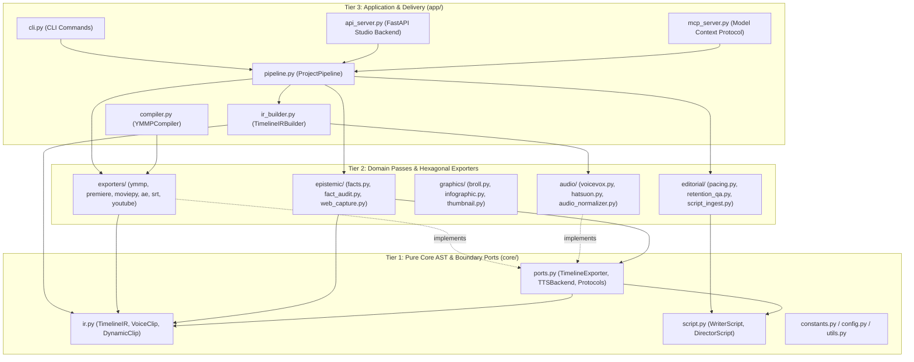
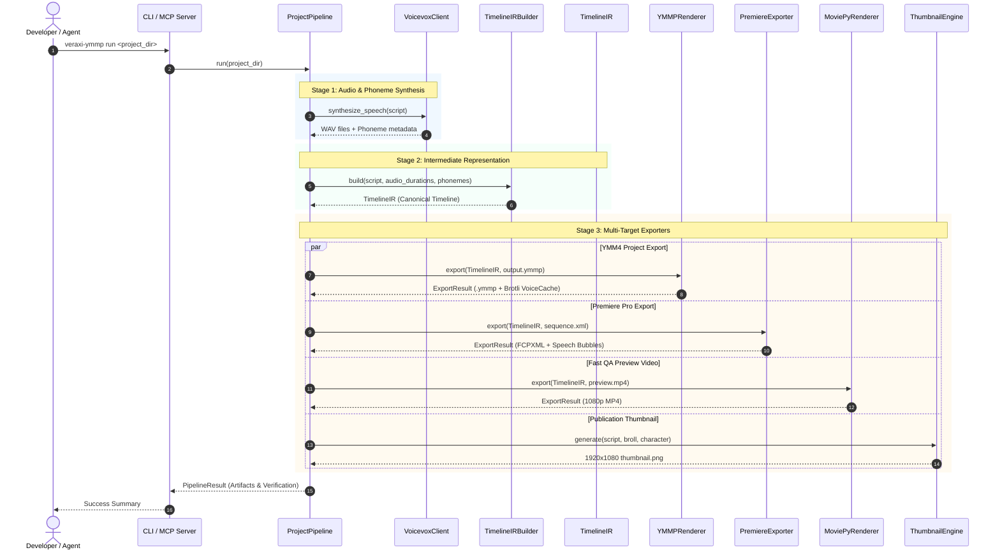

# Veraxi YMMP: Architectural Blueprint & System Design

This document details the architectural design, layer boundaries, data flow, fitness guardrails, and security invariants governing `veraxi-ymmp`.

---

## 1. Architectural Philosophy: 3-Tier Compiler & Hexagonal Targets

`veraxi-ymmp` is structured as a **Multi-Target Media Compiler with Static Analysis Gates** (modeled after Pandoc / LLVM / Manim). Dependencies flow strictly downwards (`Tier 3 -> Tier 2 -> Tier 1`):

```text
veraxi_ymmp/
├── core/        [Tier 1] Pure AST, TimelineIR, Script, Staging, Ports & Primitives (0 outer deps)
├── epistemic/   [Tier 2] Fact-Checking, Pint Units, MeCab NLP, PDF/iXBRL/Web Source Grounding
├── editorial/   [Tier 2] Pre-Production, BudouX Ingestion, Pacing & 50/30/20 Retention Linting
├── graphics/    [Tier 2] Pro Dark Slate B-Roll, Infographics, 3-Split Thumbnails, PSD & Typography
├── audio/       [Tier 2] VoiceVox TTS, Hatsuon Pitch Accent, Phonetics, EBU R128 (-16 LUFS) & SFX
├── exporters/   [Tier 2] Hexagonal Targets: YMM4 (.ymmp), Premiere (.xml), MoviePy (.mp4), AE, SRT, YouTube
└── app/         [Tier 3] Orchestration Pipeline, Compiler, CLI, FastAPI Studio & MCP Server
```



---

## 2. Layer Definitions & Component Breakdown

### 2.1. Tier 1: Pure Core AST & Boundary Ports (`veraxi_ymmp/core/`)
- **`ir.py`**: Defines `TimelineIR`, the canonical Intermediate Representation of a multi-track timeline. Includes `IRClip`, `VoiceClip`, `CharacterClip`, `GlobalClip`, `DynamicImageClip`, and `DynamicAudioClip`. Timeline IR is completely decoupled from rendering logic, JSON schemas, XML dialects, or file systems.
- **`script.py`**: Typed data contracts for the two-stage authoring pipeline:
  - `WriterScriptEntry`: Pure factual dialogue (`character`, `text`).
  - `DirectorScriptEntry`: Dialogue enriched with staging metadata (`emotion`, `motion`, `bgm`, `sfx`, `image`, `character_position`, `subtitle_position`, `subtitle_style`).
- **`ports.py`**: Hexagonal protocols and boundary contracts:
  - `TimelineExporter`: Protocol defining unified export contract (`export(ir, output_path, options) -> ExportResult`).
  - `ExportResult`: Standardized DTO capturing target format (`ymmp`, `fcpxml`, `mp4`, `jsx`, `srt`, `youtube`), output file path, generated sidecars, and execution metrics.
  - `TTSBackend`: Protocol abstracting speech synthesis backends.
  - `DirectorProvider`: Protocol for autonomous script direction and staging engines.
  - `DocumentCaptureSpec` & `DocumentCaptureAdapter`: Generic document proof capture contracts.
- **`constants.py`**: Pure domain constants including standard frame rates (`DEFAULT_FPS = 60`), frame-per-character estimations, canvas dimensions (1920x1080), BGM ducking targets, and character definitions.
- **`config.py`**: Typed compiler and project configuration models.
- **`utils.py` & `logging.py`**: Path traversal protection (`validate_output_path`), filename sanitization, and structured logging.

### 2.2. Tier 2: Domain Passes & Hexagonal Exporters

#### Epistemic Verification (`veraxi_ymmp/epistemic/`)
- **`facts.py` & `fact_audit.py`**: Epistemic fact-checking engine supporting domain profiles (`GENERAL`, `TECH`, `ACADEMIC`, `FINANCE`, `LORE`). Verifies primary source quotes, enforces institutional deduplication, and writes `sources.md`.
- **`epistemic_units.py`**: Dimensional safety engine enforcing physical and financial unit invariants via Pint.
- **`web_capture.py`, `edgar_capture.py`, `fred_capture.py`**: Captures and highlights verbatim evidence passages with cryptographic SHA-256 provenance records.

#### Editorial Pre-Production (`veraxi_ymmp/editorial/`)
- **`script_ingest.py`**: Ingests NotebookLM raw markdown dialogue and evidence tables into validated `script.json` and `claims.json` using Google `budoux` Japanese phrase segmentation.
- **`pacing.py` & `retention_qa.py`**: Enforces audience retention heuristics: 50/30/20 cast allocation, hook protection, mid-roll attention resets, dialogue ping-pong, and cognitive load limits.

#### Graphics & Visual Design (`veraxi_ymmp/graphics/`)
- **`broll.py` & `infographic.py`**: Pro Dark Slate (`#0F172A`) B-roll slides, 4-stage domino causality chains, and declarative layout rendering.
- **`thumbnail.py` & `thumbnail_composer.py`**: High-CTR publication thumbnails applying 3-split rule (3分割法), 22px character sticker outlines, and timestamp dead-zone protection.
- **`typography.py` & `subtitle_plate.py`**: Kinsoku Shori (禁則処理) line-breaking, two-line balancing, and multi-layer outline typography (袋文字).
- **`psd_registry.py`**: Photoshop PSD standing image asset discovery and layer extraction.

#### Audio Engineering (`veraxi_ymmp/audio/`)
- **`voicevox.py`**: HTTP client connecting to local VOICEVOX engine REST endpoints (`/audio_query`, `/synthesis`).
- **`hatsuon.py` & `phonetics.py`**: Kanji-to-Katakana pronunciation conversion (`Hatsuon`) and phonetic mora block extraction.
- **`audio_normalizer.py`**: Two-pass EBU R128 / ITU-R BS.1770 audio loudness normalizer using FFmpeg `loudnorm` filter (-16 LUFS YouTube, -14 LUFS broadcast).
- **`sfx.py`**: Sound effect placement and audio ducking coordinators.

#### Hexagonal Target Exporters (`veraxi_ymmp/exporters/`)
- **`ymmp_renderer.py` & `ymmp_utils.py`**: Generates YukkuriMovieMaker4 (`.ymmp`) project JSON with embedded Brotli voice caches and mouth sync animations.
- **`premiere_exporter.py`**: Produces Final Cut Pro XML (`xmeml`) for Adobe Premiere Pro across 4 video tracks and 3 audio tracks.
- **`moviepy_renderer.py`**: Fast software renderer producing MP4 preview videos with speech bubbles and lip-sync for CI/CD and pre-flight QA.
- **`ae_renderer.py`**: Generates Adobe After Effects ExtendScript (`.jsx`) compositions with procedural bounce effects.
- **`srt_generator.py`**: Generates standard RFC-compliant `.srt` subtitle files with millisecond precision.
- **`youtube_adapter.py` & `youtube_metadata.py`**: Direct YouTube API publishing, Chapter generation, and metadata packages.

### 2.3. Tier 3: Application Services & Delivery (`veraxi_ymmp/app/`)
- **`pipeline.py` (`ProjectPipeline`)**: Unified production orchestrator connecting audio synthesis, IR construction, and multi-target exports.
- **`ir_builder.py` (`TimelineIRBuilder`)**: Synthesizes timing data, phonemes, and script entries into a mathematically aligned `TimelineIR`.
- **`compiler.py` (`YMMPCompiler`)**: High-level facade coordinating template inspection, `TimelineIRBuilder`, and `YMMPRenderer`.
- **`api_server.py`**: FastAPI backend powering the desktop-grade **veraxi Studio** visual NLE interface.
- **`cli.py` & `cli_capture.py`**: Command-line interface with subcommands (`run`, `render`, `normalize`, `broll`, `thumbnail`, `capture`, `validate`, `serve`, `ingest-script`, `ideate`).
- **`mcp_server.py`**: Model Context Protocol server enabling autonomous agent invocation.

---

## 3. End-to-End Data Flow



---

## 4. Dependency Direction Rules & Architectural Fitness Functions

The architecture is continuously guarded by automated fitness functions defined in `tests/test_architectural_fitness.py`:

| Fitness Guard | Verification Method | Invariant Enforced |
|---|---|---|
| `test_strict_three_tier_compiler_dag` | AST Inspection | Dependencies flow strictly downwards: Tier 3 (`app/`) -> Tier 2 -> Tier 1 (`core/`). Modules in `core/` have zero outer dependencies. Tier 2 modules never import from Tier 3. |
| `test_runtime_tier1_import_isolation` | Runtime Subprocess | Importing Tier 1 (`veraxi_ymmp.core.ir`) never pollutes `sys.modules` with Tier 2 or Tier 3 packages at runtime. |
| `test_ports_layer_purity` | AST Inspection | Boundary protocol module (`core/ports.py`) only imports Tier 1 core modules or standard library. |
| `test_no_cross_adapter_imports` | AST Inspection | Exporter adapters (`ymmp_renderer.py`, `premiere_exporter.py`, `moviepy_renderer.py`, `ae_renderer.py`, `srt_generator.py`) **never** import from peer exporters. |
| `test_no_loose_modules_in_package_root` | Directory Scan | Package root contains only `__init__.py` and `__main__.py`. All code lives in bounded subpackages. |
| `test_no_loose_scripts_in_repo_root` | Directory Scan | Repository root contains zero loose `.py` or `.jsx` scripts. |
| `test_module_size_ceiling` | Source Line Count | No module in `veraxi_ymmp/` may exceed 900 lines of code, preventing God objects. |
| `test_no_wildcard_imports_in_library` | AST Inspection | Zero `from module import *` statements allowed across the library. |
| `test_no_raw_print_in_core_modules` | AST Inspection | Zero raw `print()` calls in core library modules. |
| `test_mypy_strict_clean` | Static Type Checker | Zero type discrepancies under strict Mypy configuration. |

---

## 5. Security, Privacy & Local Path Guardrails

`veraxi-ymmp` implements strict defense-in-depth measures against accidental leakage of developer identities, local paths, and secrets:

1. **Local Path Invariant Scanner (`scripts/check_no_local_paths.py`)**:
   - Recursively inspects all staged text files, code, tests, and scripts.
   - Forbids hardcoded Windows (`C:\Users\<user>`) and Unix (`/Users/<user>`, `/home/<user>`) directories.
   - Forbids occurrences of the active operating system's username (`getpass.getuser()`).
   - Verified by unit tests in `tests/test_architectural_fitness.py` (`test_no_hardcoded_user_paths_or_os_username`).
2. **Secret Scanning**:
   - **Gitleaks**: Integrated in `.github/workflows/ci.yml` and `.pre-commit-config.yaml` to detect API keys, fine-grained PATs, AWS credentials, and tokens.
   - **Yelp Detect-Secrets**: Configured with `.secrets.baseline` in pre-commit hooks to block high-entropy secrets.
3. **Pre-commit Automation (`.pre-commit-config.yaml`)**:
   - Enforces Ruff formatting and linting, whitespace sanitation, Gitleaks, detect-secrets, and `check_no_local_paths.py` before any commit is accepted.
